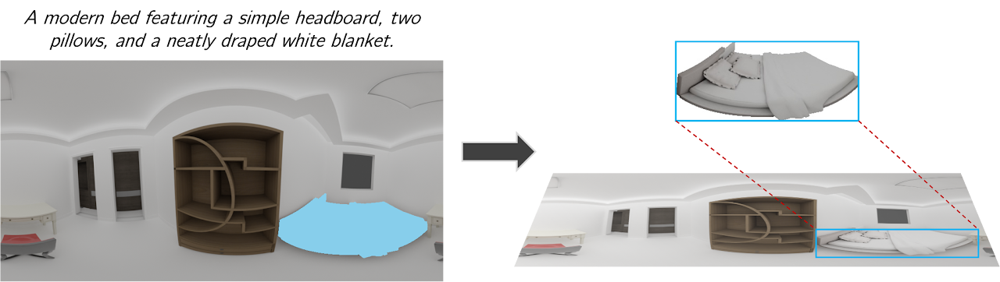

# ROOMELSA-SHREC2025

A 3D object retrieval system for room elements and shapes, designed for the SHREC 2025 challenge.

## Overview

This project is a comprehensive 3D object retrieval system designed for the SHREC 2025 challenge. The primary goal is to retrieve relevant 3D models of room elements and furniture from a large database based on natural language text queries.

<p align="center">
  
</p>

The system provides an end-to-end solution, from data processing and feature extraction to a web-based interface for interactive retrieval and visualization.

## Methodology

The methodology is divided into three main stages: Data Preparation, Feature Extraction, and Retrieval.

### 1. Data Preparation

3D models are first converted into a format suitable for feature extraction. This involves two steps:

- **Multi-View Rendering**: Each 3D object is rendered from multiple viewpoints to capture its geometric and textural information from different angles. This process generates a set of 2D images for each 3D model.
- **Point Cloud Generation**: The rendered images and their corresponding depth maps are used to generate colored point clouds, which serve as the primary 3D representation for our feature extraction model. Each point in the cloud has both spatial coordinates (X, Y, Z) and color information (R, G, B).

### 2. Feature Extraction

We employ a deep learning model from the OpenShape project to learn a joint embedding space for 3D shapes and text.

- **Model Architecture**: The system uses a point cloud-based encoder, such as PointBERT or PointNeXt, to transform a 3D point cloud $P$ into a high-dimensional feature vector $v_P \in \mathbb{R}^d$. Simultaneously, a pre-trained text encoder (from OpenCLIP) is used to convert a text query $T$ into a feature vector $v_T \in \mathbb{R}^d$ of the same dimension.

- **Training**: The model is trained using a contrastive learning approach. Given a set of $N$ pairs of point clouds and their corresponding text descriptions $\{(P_i, T_i)\}_{i=1}^N$, the objective is to minimize the contrastive loss. The similarity between a point cloud $P_i$ and a text query $T_j$ is measured by the cosine similarity of their embeddings:

$$s(i, j) = \frac{v_{P_i} \cdot v_{T_j}}{\|v_{P_i}\| \|v_{T_j}\|}$$

The training objective is to maximize the similarity of corresponding pairs $(P_i, T_i)$ while minimizing the similarity of non-corresponding pairs. This is achieved using the InfoNCE loss, which is a form of cross-entropy loss. For a given point cloud $P_i$, the loss is:

$$\mathcal{L}_{P_i} = -\log \frac{\exp(s(i, i) / \tau)}{\sum_{j=1}^N \exp(s(i, j) / \tau)}$$

where $\tau$ is a temperature parameter that controls the sharpness of the distribution. A symmetric loss is calculated for the text query $T_i$, and the total loss is the average of the two:

$$\mathcal{L}_{\text{total}} = \frac{1}{2N} \sum_{i=1}^N (\mathcal{L}_{P_i} + \mathcal{L}_{T_i})$$

### 3. Retrieval

The retrieval process is facilitated by a vector database and a web-based user interface.

- **Indexing**: The extracted feature vectors for all 3D models in the database are indexed and stored in a Qdrant vector database for efficient similarity search.

- **Querying**: When a user enters a text query, it is encoded into a feature vector using the same text encoder used during training. This query vector is then used to search the Qdrant database to find the 3D models with the most similar feature vectors, based on cosine similarity.

- **Ranking**: The retrieved models are ranked based on their similarity scores and presented to the user through a web interface.

## Evaluation Method

The performance of the retrieval system is evaluated using a combination of similarity metrics. The final score for a retrieved object is a weighted combination of multiple similarity measures:

- **Cosine Similarity**: The primary metric for retrieval is the cosine similarity between the query text embedding and the 3D shape embedding in the learned joint feature space.

- **Chamfer Distance**: For more fine-grained shape similarity assessment, we use the Chamfer Distance. It measures the distance between two point clouds, $P_1$ and $P_2$, and is defined as:

$$d_{CD}(P_1, P_2) = \frac{1}{|P_1|} \sum_{x \in P_1} \min_{y \in P_2} \|x - y\|_2^2 + \frac{1}{|P_2|} \sum_{y \in P_2} \min_{x \in P_1} \|x - y\|_2^2$$

To improve the accuracy of the Chamfer Distance, point clouds are first aligned using Principal Component Analysis (PCA) and the Iterative Closest Point (ICP) algorithm.

- **Combined Score**: The final ranking score is a weighted sum of the cosine similarity and a score derived from the Chamfer distance. The `advanced_scoring` function in `RetrievalSystem/score/calculate_score.py` implements this logic:

$$\text{Score} = w_1 \cdot \text{sim}_{\text{cosine}}(v_T, v_P) + w_2 \cdot f(d_{CD}(P_T, P_P))$$

where $P_T$ is the point cloud of the query shape (if applicable) and $P_P$ is the point cloud of the retrieved shape, and $f(\cdot)$ is a function that converts the Chamfer distance to a similarity score.

## Leaderboard

Here is the performance of our team (Ai-Yahh) in comparison to others on the SHREC 2025 challenge leaderboard.

| Team Name             | R@1      | R@5      | R@10     | MRR      |
| --------------------- | -------- | -------- | -------- | -------- |
| Stubborn_Strawberries | 0.94     | 1.00     | 1.00     | 0.97     |
| **Ai-Yahh**           | **0.92** | **1.00** | **1.00** | **0.96** |
| MealsRetrieval        | 0.92     | 1.00     | 1.00     | 0.96     |
| BUCCI_GANG            | 0.90     | 1.00     | 1.00     | 0.95     |
| NoResources           | 0.88     | 1.00     | 1.00     | 0.93     |

## How to Run the Project

### 1. Setup Environment

#### Prerequisites

- [Docker](https://docs.docker.com/get-docker/) (version 20.10 or higher)
- [Docker Compose](https://docs.docker.com/compose/install/) (version 1.29 or higher)
- [NVIDIA Docker Runtime](https://github.com/NVIDIA/nvidia-docker) (for GPU support)

#### Build and Start Services

```bash
# Clone the repository
git clone <repository-url>
cd ROOMELSA-SHREC2025

# Build the Docker image
docker-compose build

# Start all services (Qdrant + ROOMELSA)
docker-compose up -d

# Access the container shell
docker-compose exec roomelsa bash

# Inside the container, activate the conda environment
source activate roomelsa
```

The Docker setup includes:

- **ROOMELSA container**: All dependencies for rendering, training, and inference
- **Qdrant container**: Vector database for retrieval system
- **Persistent volumes**: For data, pretrained models, and outputs
- **GPU support**: Automatic GPU access via NVIDIA Docker runtime

#### Verify Installation

```bash
# Check if PyTorch detects GPU
docker-compose exec roomelsa bash -c "source activate roomelsa && python -c 'import torch; print(torch.cuda.is_available())'"

# Check Qdrant status
curl http://localhost:6333/
```

### 2. Data Preparation

All commands should be executed inside the Docker container:

```bash
# Access the container
docker-compose exec roomelsa bash
source activate roomelsa
```

1.  Organize your 3D models in the `data/` directory (automatically mounted in the container).
2.  Use the `Render/Object.ipynb` notebook to create a JSON file that catalogs your dataset.
3.  Run the `Render/main.py` script to perform multi-view rendering of the 3D models:
    ```bash
    python Render/main.py --data_root ./data --json_path ./data/object.json --output_dir ./output
    ```
4.  Convert the rendered outputs to point clouds using the `ObjectToNpy.py` script:
    ```bash
    python ObjectToNpy.py --input_dir ./output --output_dir ./data/point_clouds
    ```

### 3. Training (Fine-tuning OpenShape)

1.  Prepare your dataset of point clouds and corresponding text embeddings as described in `OpenShape_code/OUR_GUIDELINE.md`.
2.  Configure your training in `OpenShape_code/src/configs/custom_train.yaml`.
3.  Start training by running (inside the Docker container):
    ```bash
    python OpenShape_code/src/main.py --config OpenShape_code/src/configs/custom_train.yaml
    ```

### 4. Indexing Data in Qdrant

The Qdrant service is automatically started via Docker Compose and accessible at `http://qdrant:6333` (inside container) or `http://localhost:6333` (from host).

1.  Extract features for all your 3D models (inside the Docker container):
    ```bash
    python OpenShapeInference.py --model_path ./pretrained/model.pt --input_dir ./data/point_clouds --output_dir ./output/features
    ```
2.  Use the `RetrievalSystem/Qdrant.ipynb` notebook to create collections in Qdrant and upload the extracted feature vectors.

### 5. Running the Retrieval System

1.  Start the Flask server (inside the Docker container):
    ```bash
    cd RetrievalSystem
    python app.py
    ```
2.  Open your web browser and navigate to `http://localhost:5000` to use the retrieval system.

### 6. Stopping Services

```bash
# Stop all services
docker-compose down

# Stop and remove all data (including volumes)
docker-compose down -v
```
